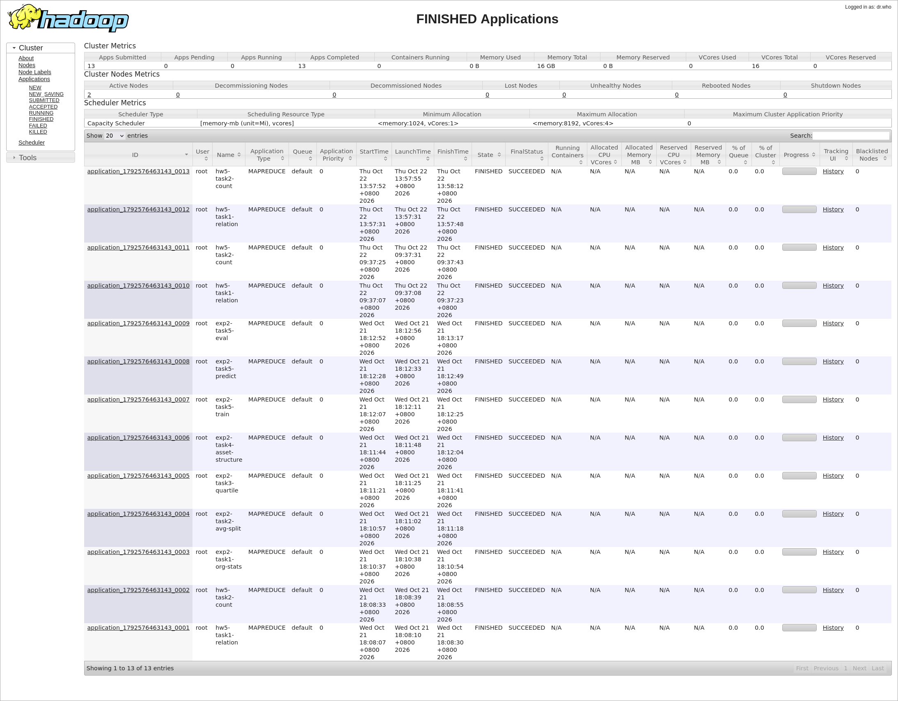
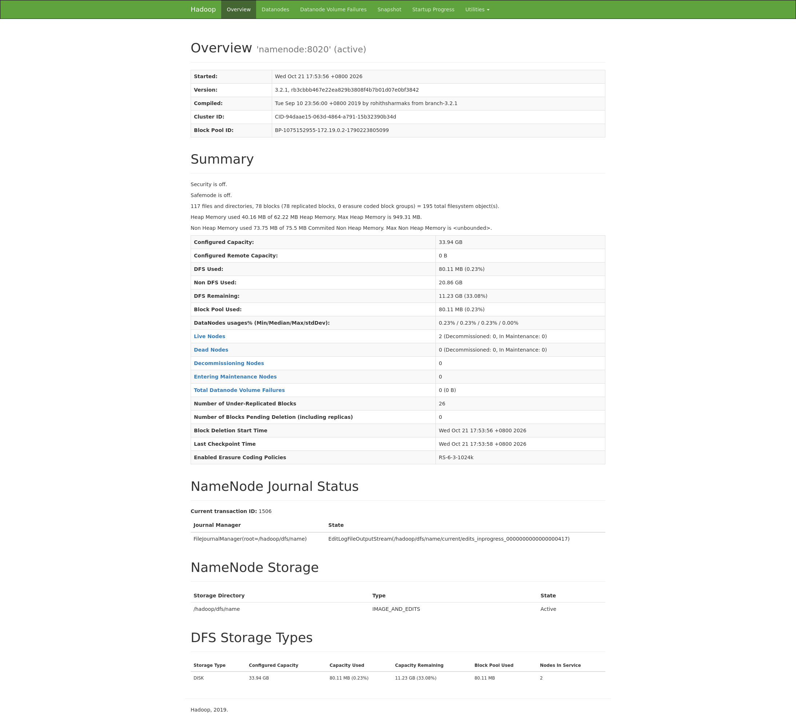
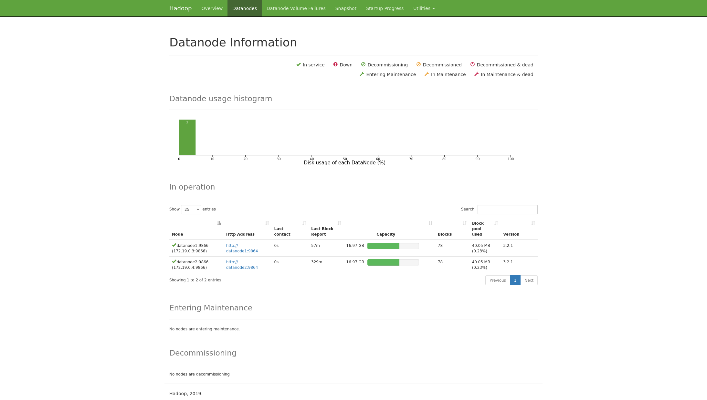
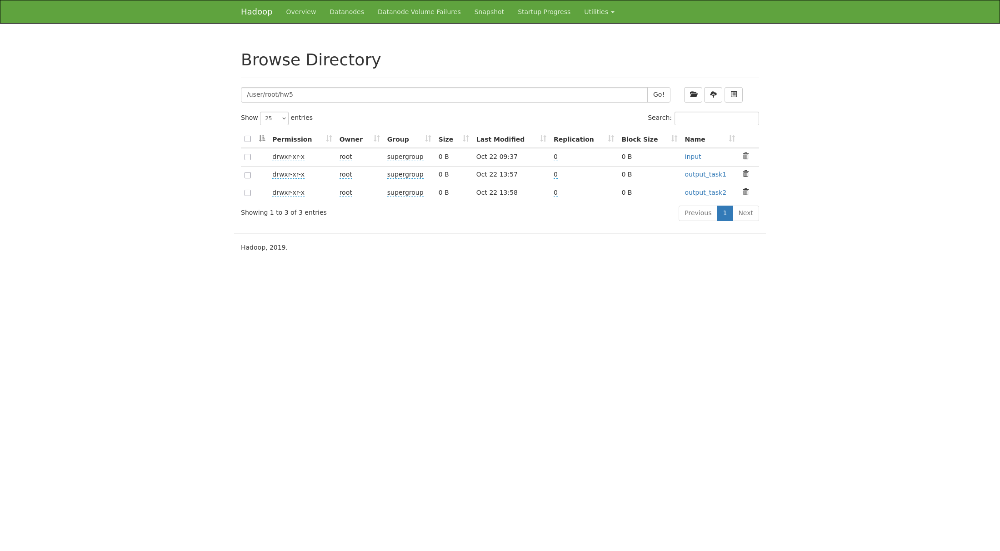

# 作业五：MapReduce 求指数成分股集合关系

用 MapReduce 比较 `A.txt` 和 `B.txt` 里三个指数的成分股：标出交集、只在 A、只在 B，再统计每个指数的交集、差集和并集数量。

程序在 `lab1` 已经配好的 Docker Hadoop 3.2.1 集群上跑完。集群有 1 个 NameNode、2 个 DataNode、1 个 ResourceManager、2 个 NodeManager。YARN 上两个作业都是 SUCCEEDED。

## 设计思路

输入每行是「指数编号 + 股票代码」，分隔符是制表符或空格。同一文件里如果出现重复的「指数 + 股票」，只算一次。

任务 1：

```python
def map(文件名, 一行):
    指数, 股票 = 一行.split()
    来源 = "A" if 文件名以A开头 else "B"
    输出(指数 + 股票, 来源)

def reduce(指数和股票, 来源列表):
    来源 = 去重(来源列表)
    if "A" in 来源 and "B" in 来源:
        输出(指数和股票, "BOTH")
    elif "A" in 来源:
        输出(指数和股票, "A_ONLY")
    else:
        输出(指数和股票, "B_ONLY")
```

只用 1 个 Reducer。键是文本，Shuffle 按字典序排列后，结果是指数编号升序、股票代码升序。`101`、`102`、`103` 位数相同，字典序和数值序一致。

任务 2 读任务 1 的输出。Map 在本分片内先计数，Reduce 再把部分和相加：

```python
def map(一行):
    指数, 股票, 标记 = 一行.split()
    本分片计数[指数][标记] += 1

def 分片结束():
    for 指数, 计数 in 本分片计数:
        输出(指数, 计数)

def reduce(指数, 部分和列表):
    交集, 只在A, 只在B = 把部分和相加
    并集 = 交集 + 只在A + 只在B
    输出(指数, 交集, 只在A, 只在B, 并集)
```

键用整数，输出按指数编号升序。

列之间都是制表符。虚拟机内存大约 4GB，作业打开了 Uber 模式，Map 和 Reduce 跑在 AppMaster 里，避免再申请一堆容器把机器打满。

## 目录

```text
作业五
├── src
│   ├── Hw5Driver.java           串联两个任务
│   ├── StockRelationJob.java    任务 1
│   ├── RelationCountJob.java    任务 2
│   └── JobConf.java
├── target/hw5.jar
├── output/task1/part-r-00000
├── output/task2/part-r-00000
├── screenshots
├── pom.xml
├── A.txt
└── B.txt
```

本机没有 Maven。`target/hw5.jar` 是在 namenode 容器的 JDK 8 上，用 `javac -encoding UTF-8` 对照 Hadoop 3.2.1 的 classpath 编译的。有 Maven 时也可以：

```bash
mvn -DskipTests package
```

## 运行

先启动 `lab1` 里的集群，把 `A.txt`、`B.txt` 放到 HDFS 的同一个目录，再提交作业。jar 没有写 Main-Class，类名要写在命令里。

```bash
hdfs dfs -mkdir -p /user/root/hw5/input
hdfs dfs -D dfs.replication=2 -put -f A.txt /user/root/hw5/input/A.txt
hdfs dfs -D dfs.replication=2 -put -f B.txt /user/root/hw5/input/B.txt

hadoop jar target/hw5.jar edu.fin.hw5.Hw5Driver \
  /user/root/hw5/input \
  /user/root/hw5/output_task1 \
  /user/root/hw5/output_task2
```

集群默认副本数是 3，但只有 2 个 DataNode，所以上传时把副本设成 2。

页面：

- NameNode：<http://localhost:9870>
- YARN：<http://localhost:8088>

## 运行结果

任务 1 共 547 行，已按指数、股票代码排序。题目里的例子都在结果中：

```text
101	JPM	BOTH
101	UNH	BOTH
101	V	BOTH
101	AAPL	A_ONLY
101	KO	B_ONLY
```

任务 2：

```text
101	3	13	4	20
102	3	19	3	25
103	52	195	255	502
```

四列依次是交集、A 独有、B 独有、并集。101 和 102 与题目示例一致。103 的并集是 52 + 195 + 255 = 502。

`A.txt` 285 行、`B.txt` 320 行，文件内没有重复键。三个指数合计：交集 58，只在 A 227，只在 B 262。

## 页面截图

YARN Finished 页面里，`hw5-task1-relation` 和 `hw5-task2-count` 都是 FINISHED / SUCCEEDED。同一张图里还有实验二的 7 个作业，也全部成功。



NameNode 处于 active，两个 DataNode 都在服务中。





HDFS 上能看到输入目录和两个输出目录。



Overview 里有 26 个副本不足的块。这是集群默认副本数为 3、实际只有 2 个 DataNode 留下的旧块，不是这次作业失败。本次输出指定了副本数 2，作业本身已经成功。

## 不足和可以改进的地方

- 任务一的键是一整段文本 `指数\t股票`，顺序靠字典序。现在三个指数都是三位数，所以没问题。一旦出现 `99` 和 `100`，`100` 会排在 `99` 前面。键可以拆开：指数按整数比较，股票代码按字符串比较。
- 两份结果各自全局有序，靠的是只开 1 个 Reducer。股票再多时，可以按指数编号分区，这个本实验由于数据量小没有做，但是数据量大需要多个reducer的时候就很有必要，每个 Reduce 只给自己的指数排序。分区号和指数顺序一致时，把 `part-r-00000`、`part-r-00001` 按文件名接起来，整体仍然有序。
